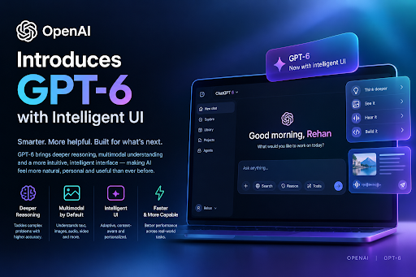
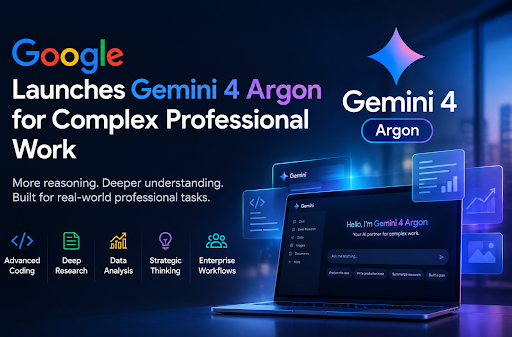
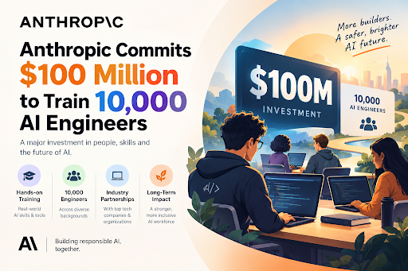
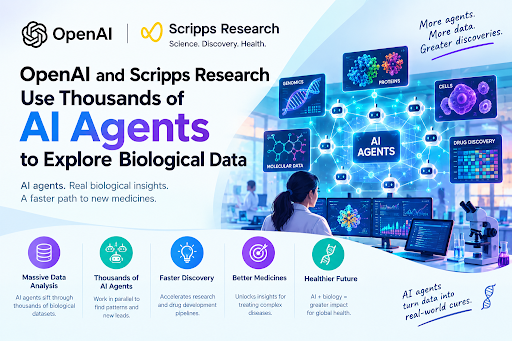
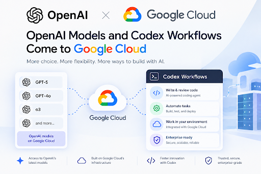

October 2026 highlighted significant advancements in artificial intelligence, focusing on interactive AI systems, professional workflows, scientific research, and enterprise integration. OpenAI introduced GPT-6 with Intelligent UI, enabling interactive responses through diagrams, comparisons, and tools, while Google launched Gemini 4 Argon to support complex professional tasks. Anthropic committed $100 million to its Claude Frontier Academy initiative, aiming to train 10,000 AI engineers by the end of 2027. Meanwhile, OpenAI, PerturbAI, and Scripps Research demonstrated the potential of multi-agent AI systems to accelerate biological research by analyzing large-scale datasets. The partnership between OpenAI and Google Cloud further expanded enterprise access to advanced AI models and Codex workflows. Overall, these developments emphasize the importance of practical AI integration, infrastructure compatibility, skilled professionals, cybersecurity, and responsible deployment in building reliable and efficient real-world AI solutions.

# October 2026: AI News Highlights

## 1. OpenAI Introduces GPT-6 with Intelligent UI [^1]

OpenAI expanded GPT-6 access in ChatGPT and introduced Intelligent UI, a feature that lets responses combine text, diagrams, comparisons, and interactive tools instead of plain paragraphs. ChatGPT can also begin responding while it keeps working, adding findings as they become available. The rollout is global, starting with paid plans and extending to Free and Go users, with safety improvements described alongside the GPT-6 models. The update shows assistants evolving from text generators into interactive interfaces for completing tasks. 

## 2. Google Launches Gemini 4 Argon for Complex Professional Work [^2]

Google launched Gemini 4 Argon, a flagship model built for developers and businesses handling multi-step work in software development, finance, law, cybersecurity, and scientific research. Google reports that teams using it in the Antigravity environment raised agentic code submissions by over 35% and cut code rollbacks by nearly a third, with early testers including Deloitte, LexisNexis, Ambience Healthcare, and Isomorphic Labs. Google also widened its Fairwind cybersecurity initiative to more vetted partners, giving them a version of the model for defensive security work.

## 3. Anthropic Commits $100 Million to Train 10,000 AI Engineers [^3]
 

Anthropic announced a $100 million commitment to create Claude Frontier Academy, which aims to train 10,000 Frontier Deployed Engineers by the end of 2027. The program teaches practical skills such as choosing suitable business problems, building AI-powered workflows, evaluating performance, and meeting security requirements, using realistic enterprise scenarios and live projects. Early cohorts included professionals linked to Accenture, Bain, Deloitte, McKinsey, Morgan Stanley, and Novo Nordisk. The initiative signals that powerful models alone are not enough; businesses also need people who can deploy them.

## 4. OpenAI and Scripps Research Use Thousands of AI Agents to Explore Biological Data [^4]

OpenAI, PerturbAI, and Scripps Research reported an experiment in which thousands of GPT-Rosalind agents analyzed data from millions of mouse brain cells in parallel, finishing in about 32 minutes according to OpenAI. Their findings were merged into a reasoning atlas linking genes, cellular effects, publications, and possible mechanisms, and surfaced leads such as a potential connection between cholesterol regulation and neurodegeneration. In blinded comparisons, human experts preferred the multi-agent reports over single-agent reports 75% of the time. These are research leads, not confirmed treatments, and further experiments are required.

## 5. OpenAI Models and Codex Workflows Come to Google Cloud [^5]

OpenAI and Google Cloud announced a partnership to bring OpenAI's frontier models and Codex agentic workflows into Google Cloud's Model Garden, letting enterprises use them within their existing infrastructure, access controls, and compliance policies. Plans also include making the models available through Google Antigravity and Gemini Agent. The move shows competition shifting from model quality alone toward distribution, infrastructure compatibility, governance, and deployment cost. 

## Core Considerations for AI's Practical Integration

As AI evolves toward practical applications across industries, several critical considerations emerge:

- **Workflow Integration**: Embedding AI into real-world professional tasks, including software development, finance, and scientific research.
- **Infrastructure Compatibility**: Integrating AI models with existing cloud platforms, enterprise systems, and deployment environments.
- **Human Expertise and Training**: Developing skilled professionals capable of building, evaluating, and deploying AI-powered workflows.
- **Multi-Agent Collaboration**: Using multiple AI agents to analyze complex datasets and accelerate scientific discoveries.
- **Security and Responsible Deployment**: Strengthening cybersecurity measures and ensuring AI systems operate safely within real-world environments.

## Conclusion

October 2026 showed AI advancing on several connected fronts: more interactive assistants with GPT-6, professional-grade workflows with Gemini 4 Argon, investment in the engineers who deploy AI, and multi-agent systems accelerating scientific exploration. The OpenAI and Google Cloud partnership showed frontier models spreading across enterprise platforms, while AI-driven vulnerability discovery underlined the need for responsible deployment. Overall, the AI race is no longer defined only by individual models; it is increasingly about how well AI is integrated into real work, supports scientific progress, and operates safely within the systems people depend on.

## References

[^1]: [OpenAI — GPT-6 and Intelligent UI for Everyone](https://openai.com/index/gpt-6-for-everyone/)

[^2]: [Reuters — Google Launches Gemini 4 Argon](https://www.reuters.com/business/google-launches-flagship-ai-model-gemini-4-argon-developers-businesses-2026-10-13/)

[^3]: [Anthropic — Claude Frontier Academy](https://www.anthropic.com/news/claude-frontier-academy)

[^4]: [OpenAI — Using Thousands of AI Agents to Uncover New Leads in Biological Data](https://openai.com/index/scaling-ai-research-for-complex-biological-data/)

[^5]: [OpenAI — OpenAI Models Are Coming to Google Cloud](https://openai.com/index/openai-models-google-cloud/)
